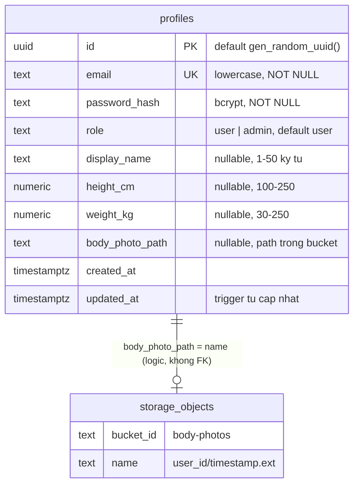

# Thiết kế Database & Storage – Sprint 1

Phạm vi: US-01 (đăng ký/đăng nhập), US-02 (hồ sơ + ảnh toàn thân). Migration: [`migrations/`](../../migrations/README.md).

## Mục lục
1. [Nguyên tắc chung](#1-nguyên-tắc-chung)
2. [ERD](#2-erd)
3. [Bảng profiles](#3-bảng-profiles)
4. [Storage: bucket body-photos](#4-storage-bucket-body-photos)
5. [Bảo mật (RLS & quyền)](#5-bảo-mật-rls--quyền)
6. [Dữ liệu mẫu (dev)](#6-dữ-liệu-mẫu-dev)
7. [API contract liên quan](#7-api-contract-liên-quan)
8. [Lưu ý cho backend (Task 5–7)](#8-lưu-ý-cho-backend-task-57)

## 1. Nguyên tắc chung

- **Không dùng Supabase Auth.** Backend Express tự quản lý user: hash mật khẩu bằng `bcrypt` (cost 10), tự phát hành JWT. `profiles` là bảng user của ứng dụng, không tham chiếu `auth.users`.
- Chỉ backend truy cập DB/Storage bằng service role key qua `@supabase/supabase-js`. Frontend không bao giờ gọi Supabase trực tiếp.
- **Thuật ngữ:** "avatar" trong sprint backlog = **ảnh toàn thân** (body photo) trong US-02, dùng làm mẫu thử đồ. Trong DB/code/API thống nhất dùng `body_photo` (cột `body_photo_path`, bucket `body-photos`, JSON `bodyPhotoUrl`). Không có ảnh đại diện riêng.

## 2. ERD



`storage_objects` = bảng `storage.objects` của Supabase, chỉ phần object thuộc bucket `body-photos`.

## 3. Bảng profiles

| Cột | Kiểu | Null | Default | Ràng buộc / ghi chú |
|-----|------|------|---------|---------------------|
| `id` | `uuid` | NOT NULL | `gen_random_uuid()` | PK. Dùng làm `sub` trong JWT và thư mục ảnh trong Storage |
| `email` | `text` | NOT NULL | – | `UNIQUE` (`profiles_email_key`); CHECK `email = lower(btrim(email))`; CHECK ≤ 254 ký tự và dạng `x@y.z` |
| `password_hash` | `text` | NOT NULL | – | CHECK đúng định dạng bcrypt (`$2a$`/`$2b$`/`$2y$`, 60 ký tự) → chặn lưu nhầm plaintext |
| `role` | `text` | NOT NULL | `'user'` | CHECK `in ('user','admin')` |
| `display_name` | `text` | NULL | – | CHECK null hoặc 1–50 ký tự sau trim |
| `height_cm` | `numeric(4,1)` | NULL | – | CHECK 100–250 |
| `weight_kg` | `numeric(4,1)` | NULL | – | CHECK 30–250 |
| `body_photo_path` | `text` | NULL | – | CHECK dạng `<uuid>/<tên>.jpg` hoặc `.png`; không lưu URL |
| `created_at` | `timestamptz` | NOT NULL | `now()` | |
| `updated_at` | `timestamptz` | NOT NULL | `now()` | Trigger `profiles_set_updated_at` (BEFORE UPDATE) gọi `public.set_updated_at()` |

**Index:** PK `id` (GET/PUT profile) và unique index do `profiles_email_key` tạo (login, check trùng khi đăng ký). Chưa cần index `role` (số admin ít, chưa có truy vấn lọc theo role).

**Lý do thiết kế:**
- **Email không phân biệt hoa thường:** chọn *lưu lowercase + CHECK + UNIQUE trên cột* (không dùng unique index trên `lower(email)` hay `citext`). Backend luôn `trim().toLowerCase()` trước khi ghi/so sánh; CHECK bảo đảm không dòng nào lọt chữ hoa, nên unique trên cột là đủ và `.eq('email', …)` của PostgREST dùng thẳng index.
- **`role` có ngay từ Sprint 1:** US-03/04/09 (Admin) cần phân quyền. Thêm cột default `'user'` bây giờ không ảnh hưởng tính năng Sprint 1, tránh migration sửa bảng user sau này và cho phép seed admin sớm. Dùng `text + CHECK` thay vì enum để thêm role không cần `ALTER TYPE`.
- **Chiều cao/cân nặng nullable:** user mới đăng ký chưa có số đo. Việc bắt buộc nhập khi lưu hồ sơ (US-02) kiểm tra ở backend; DB chỉ chặn giá trị ngoài khoảng. `numeric(4,1)` cho phép 1 chữ số thập phân (vd 50.5 kg).
- **Không có cột phone/địa chỉ:** Task 7 ghi "name, email, phone, etc." nhưng US-02 chỉ yêu cầu tên hiển thị, chiều cao, cân nặng, ảnh; email khoá. Không thêm field ngoài user story; thêm khi có US.

## 4. Storage: bucket body-photos

| Thuộc tính | Giá trị |
|------------|---------|
| id / name | `body-photos` |
| public | `false` (**private**) |
| `file_size_limit` | `5242880` (5 MB) |
| `allowed_mime_types` | `image/jpeg`, `image/png` |
| Path object | `<user_id>/<timestamp_ms>.<ext>`, `ext` ∈ `jpg`, `png` (`.jpeg` chuẩn hoá thành `.jpg`). Vd `11111111-1111-4111-8111-111111111111/1761609600000.jpg` |

**Private + signed URL (lý do):** ảnh toàn thân kèm số đo là dữ liệu nhạy cảm; bucket public cho phép bất kỳ ai có link xem vĩnh viễn. Vì vậy:
- DB lưu **path**, không lưu URL vĩnh viễn; API trả URL ký tạm thời.
- Backend tạo signed URL (`createSignedUrl(path, 300)`, TTL 5 phút, [D31](../PRD.md#2-quyết-định-đã-chốt)) mỗi lần trả profile. Frontend không lưu URL lâu dài; hết hạn thì gọi lại `GET /api/user/profile`.
- Timestamp trong tên file: mỗi lần thay ảnh có path mới → URL của ảnh mới không bị trả nhầm ảnh cũ từ cache. Việc này không làm URL đã cấp của ảnh cũ hết tác dụng ngay, xem [PRD mục 7](../PRD.md#7-rủi-ro-đã-chấp-nhận-và-đề-xuất-backlog).
- Sprint sau (GenAI thử đồ) backend đọc ảnh bằng service role/signed URL, không cần public.

**Thay ảnh (US-02: ảnh mới thay ảnh cũ, chỉ 1 ảnh/người):**

Trước bước 1 (Sprint 2 Task 7, đã cài đặt): encode lại ảnh bằng `sharp` để bỏ metadata, kết quả không vượt `file_size_limit` ([PRD D25–D29](../PRD.md#2-quyết-định-đã-chốt)). Lỗi ở đây thì chưa gọi Storage hay DB.

1. Upload ảnh mới vào path mới.
2. Cập nhật `profiles.body_photo_path` = path mới.
3. Nếu bước 2 lỗi → xoá ảnh mới vừa upload (rollback) và trả lỗi.
4. Nếu bước 2 thành công và có path cũ → xoá object cũ (`storage.from('body-photos').remove([oldPath])`). Lỗi xoá chỉ ghi log, không làm hỏng request.

Xoá object luôn qua Storage API, không `DELETE` trực tiếp trên `storage.objects` (sẽ để lại file vật lý).

## 5. Bảo mật (RLS & quyền)

- `profiles`: **bật RLS, không tạo policy nào**; `revoke all` từ `anon`, `authenticated`; `grant select, insert, update, delete` cho `service_role`. Kết quả: ai có anon/publishable key gọi Data API cũng không đọc/ghi được (kể cả `password_hash`); chỉ service role (bypass RLS) truy cập. Phân quyền theo user (chỉ sửa hồ sơ của mình) làm ở backend bằng `id` lấy từ JWT, không qua RLS vì không dùng Supabase Auth.
- `storage.objects`: không tạo policy cho bucket `body-photos` → chỉ service role upload/xoá/tạo signed URL.
- Service role key chỉ ở `backend/.env`, không bao giờ gửi về client.
- Hàm trigger đặt `search_path = ''` (khuyến nghị của Supabase Security Advisor).

## 6. Dữ liệu mẫu (dev)

Không có seed. Repo public nên không commit tài khoản mẫu kèm mật khẩu hay hash (seed cũ `003` đã gỡ, các tài khoản đó đã xoá khỏi DB). Tài khoản dev tự tạo: đăng ký qua app hoặc `POST /api/auth/register`; muốn có admin thì đổi `role` bằng SQL ở môi trường dev (role trong JWT cũ giữ nguyên tới khi hết hạn, xem mục 8). Hướng dẫn chi tiết: mục "Tài khoản dev để test thủ công" trong [`README.md`](../../README.md).

## 7. API contract liên quan

Không endpoint nào trả `password_hash`. Cột DB `snake_case`, JSON `camelCase`.

| Endpoint | Đọc | Ghi |
|----------|-----|-----|
| `POST /api/auth/register` | `email` (kiểm tra trùng); `id`, `email`, `role` của dòng vừa tạo | `email` (lowercase), `password_hash`; `role` lấy default `user` (bỏ qua nếu client gửi `role`) |
| `POST /api/auth/login` | `id`, `email`, `password_hash`, `role` | – |
| `GET /api/user/profile` | `id`, `email`, `role`, `display_name`, `height_cm`, `weight_kg`, `body_photo_path` (→ signed URL), `updated_at` | – |
| `PUT /api/user/profile` | như GET | `display_name`, `height_cm`, `weight_kg`, `body_photo_path` (khi có ảnh mới). **Không** cho sửa `email`, `role`, `password_hash` |

Response profile đề xuất:

```json
{
  "id": "uuid",
  "email": "lan@example.com",
  "role": "user",
  "displayName": "Lan Nguyễn",
  "heightCm": 162,
  "weightKg": 50.5,
  "bodyPhotoUrl": "https://<ref>.supabase.co/storage/v1/object/sign/body-photos/...?token=...",
  "updatedAt": "2026-10-28T04:00:00.000Z"
}
```

`bodyPhotoUrl` = `null` khi chưa có ảnh, object không tồn tại, hoặc tạo URL lỗi. Register và login cùng trả `{ token, user: { id, email, role } }`. Request/response/mã lỗi chi tiết: [PRD mục 4](../PRD.md#4-api-contract); luồng xử lý: [`design/flows/`](../flows/).

## 8. Lưu ý cho backend (Task 5–7)

- **Email:** `trim().toLowerCase()` trước khi insert và khi tìm lúc login. Bắt lỗi Postgres `23505` (unique `profiles_email_key`) → `409` email đã tồn tại (phòng race giữa check và insert). Lỗi `23514` (CHECK) nghĩa là backend validate thiếu → trả 400, không lộ tên constraint.
- **Mật khẩu:** `bcrypt.hash(pw, 10)`; CHECK định dạng bcrypt sẽ từ chối nếu lỡ lưu plaintext. Sai email hay sai mật khẩu đều trả cùng một thông báo.
- **Select tường minh** các cột cần, không `select('*')`; chỉ lấy `password_hash` trong login.
- **JWT:** payload `{ sub: id, role }`. Đổi role thì token cũ vẫn mang role cũ đến khi hết hạn → endpoint Admin (sprint sau) nên kiểm tra lại `role` trong DB.
- **Số đo:** validate 100–250 cm / 30–250 kg, làm tròn 1 chữ số thập phân. PostgREST trả `numeric` dạng JSON number.
- **Ảnh:** validate magic bytes (JPEG/PNG, không tin MIME khai báo) + ≤ 5 MB ở backend, rồi encode lại ([PRD D25–D29](../PRD.md#2-quyết-định-đã-chốt), Task 7) trước khi upload (bucket chặn thêm một lớp). Upload với `contentType` và `ext` suy ra từ magic bytes, path `${userId}/${Date.now()}.${ext}`, theo thứ tự thay ảnh ở mục 4. `createSignedUrl` lỗi (vd object không còn trong Storage) → `bodyPhotoUrl: null`, không trả 500.
- `updated_at` do trigger cập nhật, backend không cần gửi.
