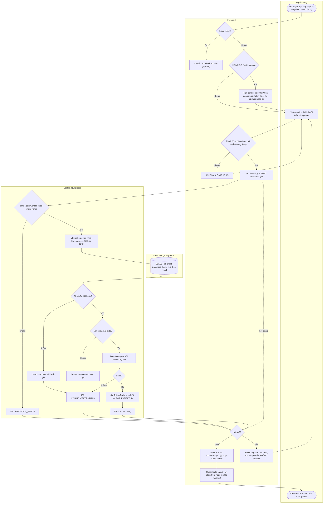

# Flow: Đăng nhập và phát hành JWT

US-01. API: [PRD 4.2](../PRD.md#42-post-apiauthlogin). Quyết định: D2, D3, D4, D6, D8.

## Nhánh lỗi

| Điều kiện | HTTP | Thông báo cho người dùng | Hành vi UI |
|-----------|------|--------------------------|------------|
| Email sai định dạng | Client chặn; nếu tới server: `401 INVALID_CREDENTIALS` | Client: Email không hợp lệ. | Lỗi dưới ô email, không gửi request |
| Thiếu email hoặc mật khẩu | Client chặn; server `400 VALIDATION_ERROR` | Vui lòng nhập email và mật khẩu. | Lỗi dưới ô tương ứng |
| Email không tồn tại hoặc mật khẩu sai | `401 INVALID_CREDENTIALS` | Email hoặc mật khẩu không đúng. | Thông báo trên form (không gắn với ô nào), giữ email, xoá mật khẩu, không redirect |
| Lỗi server | `500 INTERNAL_ERROR` | Đã có lỗi xảy ra. Vui lòng thử lại. | Thông báo trên form, giữ email |
| Lỗi mạng | Không có | Không thể kết nối tới máy chủ. Vui lòng thử lại. | Thông báo trên form, giữ email |

## Ghi chú bảo mật

- **Chống dò tài khoản:** cùng status, `code`, `message` cho sai email và sai mật khẩu; mọi nhánh 401 đều chạy đúng một lần `bcrypt.compare`. Hash giả là bcrypt cost 10, tạo một lần khi khởi động server.
- **72 byte:** mật khẩu dài hơn không thể là mật khẩu thật (đăng ký đã chặn), coi như sai thay vì để bcrypt cắt bớt rồi khớp.
- **Token:** lưu `localStorage` key `tryon_token` qua `tokenStorage` đã có. Không log token. Hạn và hệ quả: [flow logout](logout-protected-routes.md#hệ-quả-của-jwt-stateless).
- **Không có rate limit ở Sprint 1:** xem [PRD mục 7](../PRD.md#7-rủi-ro-đã-chấp-nhận-và-đề-xuất-backlog). Sơ đồ này không có bước đó.
- **Banner hết phiên:** text cố định "Phiên đăng nhập đã kết thúc. Vui lòng đăng nhập lại." cho cả `AUTH_REQUIRED`, `TOKEN_EXPIRED`, `TOKEN_INVALID` ([chi tiết](logout-protected-routes.md#hành-vi-frontend)).
- `from` lấy từ `location.state`, không lấy từ URL, nên không thể bị lợi dụng để chuyển hướng ra ngoài.
