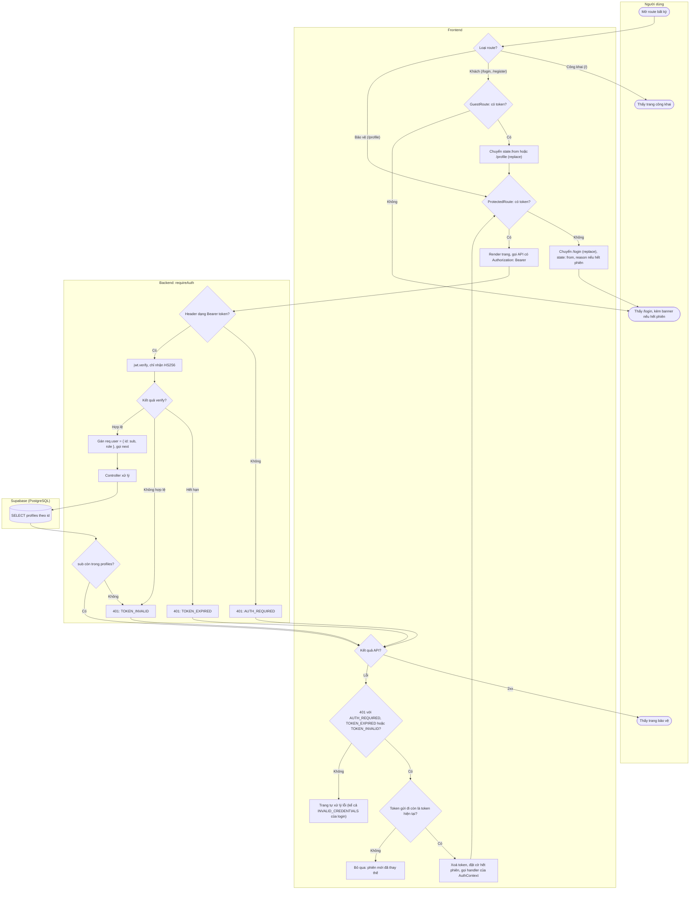
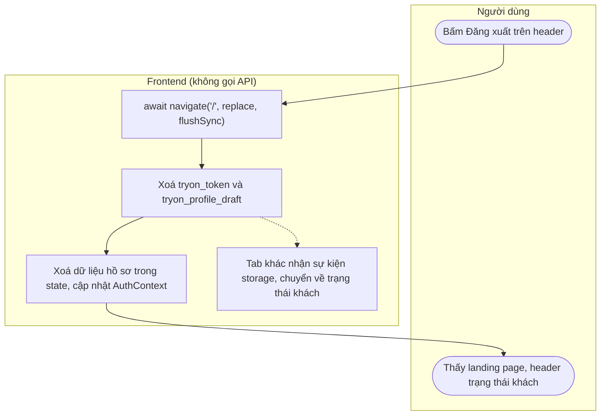

# Flow: Logout, bảo vệ route, JWT middleware, token hết hạn

US-01, US-02. Quyết định: D2–D6, D18, D19. Mã lỗi: [PRD mục 4](../PRD.md#quy-ước-chung).

## Bảo vệ route frontend và JWT middleware

## Logout

Không có Backend và Supabase trong flow này (D5). Phải điều hướng **trước** khi xoá token: nếu xoá trước, `ProtectedRoute` sẽ render lại và đưa người dùng tới `/login` thay vì `/`. Chỉ `await navigate('/', { replace: true })` là chưa đủ: promise resolve trước khi React commit route mới, nên cần thêm `flushSync: true` để route mới được commit trước khi `logout()` chạy (đã kiểm chứng trên trình duyệt).

## Nhánh lỗi

| Điều kiện | HTTP | Thông báo cho người dùng | Hành vi UI |
|-----------|------|--------------------------|------------|
| Mở route bảo vệ khi chưa đăng nhập | Không gọi API | Không có banner | Chuyển `/login`, lưu `from` |
| Thiếu hoặc sai dạng header | `401 AUTH_REQUIRED` | Banner: Phiên đăng nhập đã kết thúc. Vui lòng đăng nhập lại. | Xoá token, chuyển `/login`, lưu `from` |
| Token hết hạn | `401 TOKEN_EXPIRED` | Banner: Phiên đăng nhập đã kết thúc. Vui lòng đăng nhập lại. | Xoá token, chuyển `/login`, lưu `from`, giữ bản nháp ([flow hồ sơ](profile.md#giữ-bản-nháp)) |
| Token sai chữ ký, bị sửa, hoặc user không còn | `401 TOKEN_INVALID` | Banner: Phiên đăng nhập đã kết thúc. Vui lòng đăng nhập lại. | Như trên |
| Sai mật khẩu khi login | `401 INVALID_CREDENTIALS` | Email hoặc mật khẩu không đúng. | **Không** xoá token, **không** redirect; thông báo trên form |
| Request cũ trả 401 sau khi đã đăng nhập lại | `401` | Không có | Bỏ qua, không đăng xuất phiên mới |
| Lỗi mạng hoặc 5xx ở route bảo vệ | Không có / `5xx` | Theo từng trang | **Không** đăng xuất; trang hiện lỗi + Thử lại |

## Hành vi frontend

- **`apiClient.js`:** thêm `setSessionExpiredHandler(fn)`. Khi `status === 401` và `code` thuộc 3 mã hết phiên, và token đã gửi trùng token hiện tại: gọi `tokenStorage.clear()`, gọi handler, rồi vẫn ném `ApiError`. Chỉ lọc theo `code`, không theo URL (D18).
- **`AuthContext`:** giữ `token`, cờ `sessionExpired` và cờ `justRegistered` (`/profile` tiêu thụ một lần để hiện thông báo sau đăng ký, xoá khi logout; xem [flow đăng ký](register.md#ghi-chú)), đăng ký handler, nghe sự kiện `storage` của `tryon_token` để đồng bộ giữa các tab. Không cần gọi `navigate` ngoài component: token thành `null` làm `ProtectedRoute` tự render lại `<Navigate>` với `location` hiện tại.
- **`ProtectedRoute`:** không token thì `<Navigate to="/login" replace state={{ from, reason }} />`; `from` = `pathname + search`; `reason` = `session_expired` khi cờ bật.
- **Banner hết phiên:** `/login` hiện một banner cố định khi `state.reason === 'session_expired'`, text "Phiên đăng nhập đã kết thúc. Vui lòng đăng nhập lại.", cho cả 3 mã. `message` server của 3 mã này không hiển thị trên UI, vì chuyển trang do `ProtectedRoute` render lại nên message không tới được `/login`; `code` chỉ dùng để nhận biết hết phiên.
- **`GuestRoute`:** có token thì `<Navigate to={state?.from ?? '/profile'} replace />`. Đây là nơi **duy nhất** chuyển trang sau login và đăng ký, để tránh hai nơi cùng điều hướng. Cờ `sessionExpired` tắt khi có token mới. Link giữa `/login` và `/register` không chuyển tiếp `state.from`, nên đăng ký luôn về `/profile`.
- **Header:** có token thì hiện "Hồ sơ" và "Đăng xuất" thay cho "Đăng nhập", "Đăng ký".
- **Token đã hết hạn nhưng chưa bị phát hiện (D19):** header vẫn ở trạng thái đã đăng nhập, `/login` chuyển sang `/profile`, rồi `GET` trả 401 làm xoá token và quay lại `/login`. Không lặp vô hạn vì token đã bị xoá.

## Hệ quả của JWT stateless

- Logout chỉ xoá token ở trình duyệt hiện tại; **bản sao token, nếu có, vẫn dùng được đến khi hết hạn**. Backend không có danh sách thu hồi.
- TTL **24 giờ** (D6), đặt qua `JWT_EXPIRES_IN=24h` trong `backend/.env.example`. Không có refresh token: hết hạn thì đăng nhập lại.
- Đổi `JWT_SECRET` làm mọi token mất hiệu lực, là cách thu hồi khẩn cấp duy nhất ở Sprint 1.
- `role` trong token có thể cũ; endpoint Admin ở sprint sau cần kiểm tra lại DB ([schema mục 8](../database/schema.md#8-lưu-ý-cho-backend-task-57)).

## Ghi chú bảo mật

- `verifyToken` trong `config/jwt.js` hiện chưa giới hạn thuật toán; Task 7 thêm `{ algorithms: ['HS256'] }`.
- `requireAuth` không truy cập DB; controller xử lý trường hợp không tìm thấy dòng `profiles`.
- `requireAuth` đặt **trước** multer để request không có quyền không được đưa file vào bộ nhớ server.
- Bảo vệ ở frontend chỉ là trải nghiệm; quyền thực sự nằm ở `requireAuth`.
