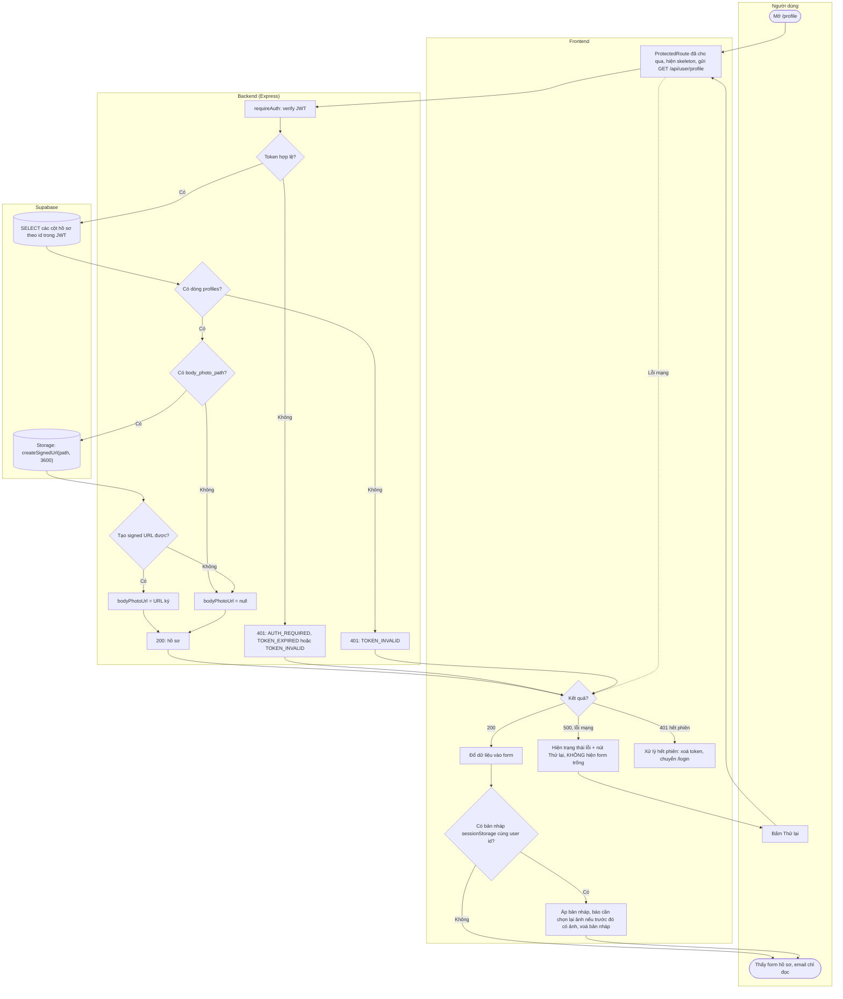
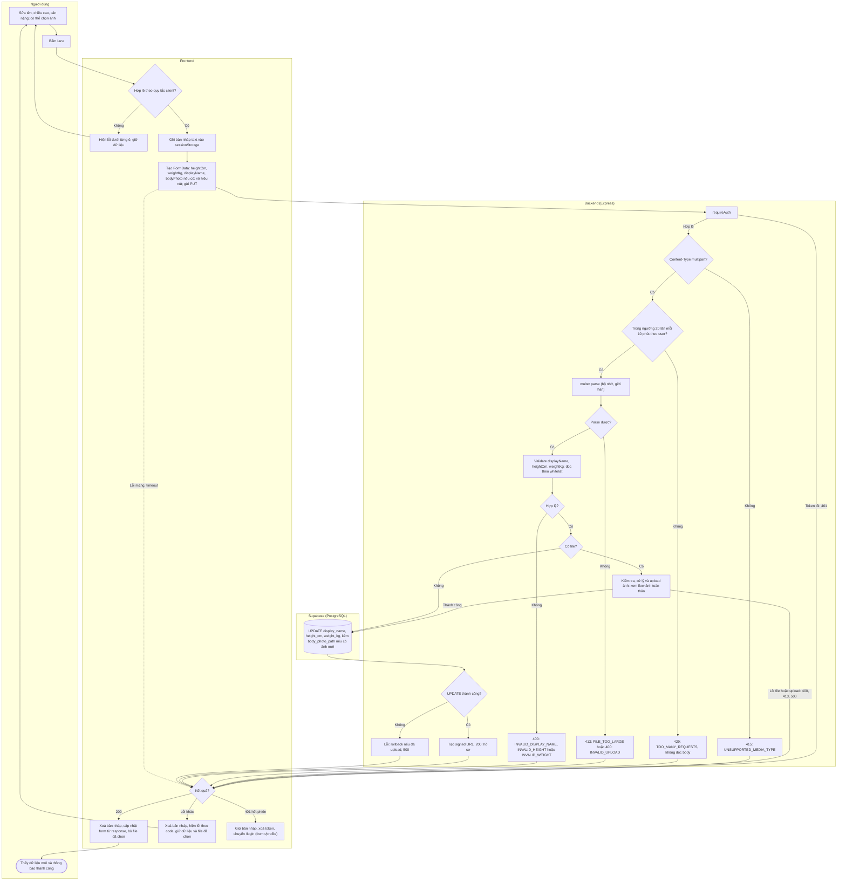

# Flow: Lấy và cập nhật hồ sơ

US-02. API: [PRD 4.3, 4.4](../PRD.md#43-get-apiuserprofile). Quyết định: D9–D14, D20–D24. Rate limit trong sơ đồ cập nhật là hành vi đích của Sprint 2 Task 6, đã chốt, chưa cài đặt. Phần xử lý file: [flow ảnh toàn thân](upload-body-photo.md). Xác thực: [flow bảo vệ route](logout-protected-routes.md).

## Lấy hồ sơ

## Cập nhật hồ sơ

## Nhánh lỗi

| Điều kiện | HTTP | Thông báo cho người dùng | Hành vi UI |
|-----------|------|--------------------------|------------|
| Token thiếu, hết hạn, không hợp lệ, hoặc tài khoản không còn tồn tại | `401` (xem [PRD 4](../PRD.md#quy-ước-chung)) | Banner ở `/login`: Phiên đăng nhập đã kết thúc. Vui lòng đăng nhập lại. | Chuyển `/login`; sau khi đăng nhập quay lại `/profile`, khôi phục bản nháp |
| Chiều cao thiếu, không phải số, ngoài khoảng | Client chặn; server `400 INVALID_HEIGHT` | Chiều cao phải là số từ 100 đến 250 cm. | Lỗi dưới ô |
| Cân nặng thiếu, không phải số, ngoài khoảng | Client chặn; server `400 INVALID_WEIGHT` | Cân nặng phải là số từ 30 đến 250 kg. | Lỗi dưới ô |
| Tên hiển thị quá dài | Client chặn; server `400 INVALID_DISPLAY_NAME` | Tên hiển thị tối đa 50 ký tự. | Lỗi dưới ô |
| Tải hồ sơ thất bại | `500` hoặc lỗi mạng | Không tải được hồ sơ. Vui lòng thử lại. | Trạng thái lỗi + Thử lại; không hiện form trống để tránh lưu đè |
| Lưu thất bại | `500 INTERNAL_ERROR` hoặc lỗi mạng | Đã có lỗi xảy ra. Vui lòng thử lại. (lỗi mạng: Không thể kết nối tới máy chủ. Vui lòng thử lại.) | Giữ toàn bộ dữ liệu và file; bật lại nút |
| Lưu quá nhiều lần | `429 TOO_MANY_REQUESTS` | Bạn đã lưu quá nhiều lần trong thời gian ngắn. Vui lòng thử lại sau 10 phút. | Thông báo chung trên form; giữ toàn bộ dữ liệu và file; bật lại nút. Không có field nào được ghi |
| Lỗi file ảnh | Xem [flow ảnh](upload-body-photo.md#nhánh-lỗi) | | Không có field nào được ghi |

## Quy tắc

- **Tất cả hoặc không gì cả (D10):** mọi field ghi trong một `UPDATE` duy nhất, sau khi upload thành công. Sau mọi lỗi, DB giữ nguyên như trước request.
- **Dòng `profiles` không còn:** `SELECT` hoặc `UPDATE` không thấy dòng thì trả `401 TOKEN_INVALID`; nếu đã upload ảnh thì rollback trước.
- **Số đo bắt buộc ở mọi lần lưu (D12):** form gửi lại giá trị đang hiển thị, nên người đã có số đo chỉ đổi tên hoặc ảnh vẫn lưu bình thường. Người chưa có số đo phải nhập trước khi lưu, kể cả khi chỉ muốn tải ảnh; UI đánh dấu hai ô này là bắt buộc từ đầu.
- **Ảnh tuỳ chọn (D13):** nếu chưa có ảnh, UI hiện nhắc "Thêm ảnh toàn thân để thử đồ" sau khi lưu nhưng không chặn.
- **Xoá tên hiển thị (D14):** xoá trống ô rồi lưu; frontend luôn gửi `displayName`, server đổi rỗng thành `null`.
- **Email:** chỉ hiển thị. Server bỏ qua `email`, `role`, `phone` và mọi field ngoài whitelist (D11).
- **Nút Lưu** chỉ bật khi form có thay đổi và form đã tải xong.
- **Thứ tự kiểm tra ở server (D20, D21):** xác thực → Content-Type → rate limit → parse multipart. `PUT` không có parser JSON nên JSON hỏng nhận `401` hoặc `415`, không nhận `400 INVALID_JSON`.
- **Rate limit (D22, D23):** đếm cả request thất bại và request không có file. `415` không bị đếm. Thông báo ghi sẵn 10 phút là thời gian chờ tối đa nên UI không đọc `Retry-After`.

## Giữ bản nháp

| Tình huống | Hành vi |
|------------|---------|
| Lỗi validate, `4xx` (gồm `429`), `5xx`, lỗi mạng | Form giữ nguyên trong bộ nhớ, kể cả file đã chọn |
| Token hết hạn lúc gửi `PUT` hoặc lúc gọi `GET` làm mới ảnh khi form đang sửa | Text còn lại, **file bị mất**. Sau khi đăng nhập lại về `/profile`, form khôi phục text và báo: "Đã giữ lại thông tin bạn nhập. Vui lòng chọn lại ảnh." |

Cách làm: **trước mỗi request** từ `/profile` khi form có thay đổi, ghi `{ userId, displayName, heightCm, weightKg, hadPhoto }` vào `sessionStorage` key `tryon_profile_draft` (ghi trước để không phụ thuộc thứ tự redirect). Xoá khi request kết thúc không phải vì hết phiên, khi logout, hoặc sau khi khôi phục. Chỉ khôi phục khi `userId` khớp hồ sơ vừa tải; không khớp thì xoá (máy dùng chung). `sessionStorage` chỉ sống trong tab nên số đo không tồn tại lâu dài trên máy. File không lưu được vào `sessionStorage`, và IndexedDB là quá mức cần cho tình huống hiếm này.

## Ghi chú bảo mật

- `id` luôn lấy từ `sub` của JWT; request không có tham số user id nên không thể sửa hồ sơ người khác.
- Select tường minh, không lấy `password_hash` (schema mục 8). Không log số đo.
