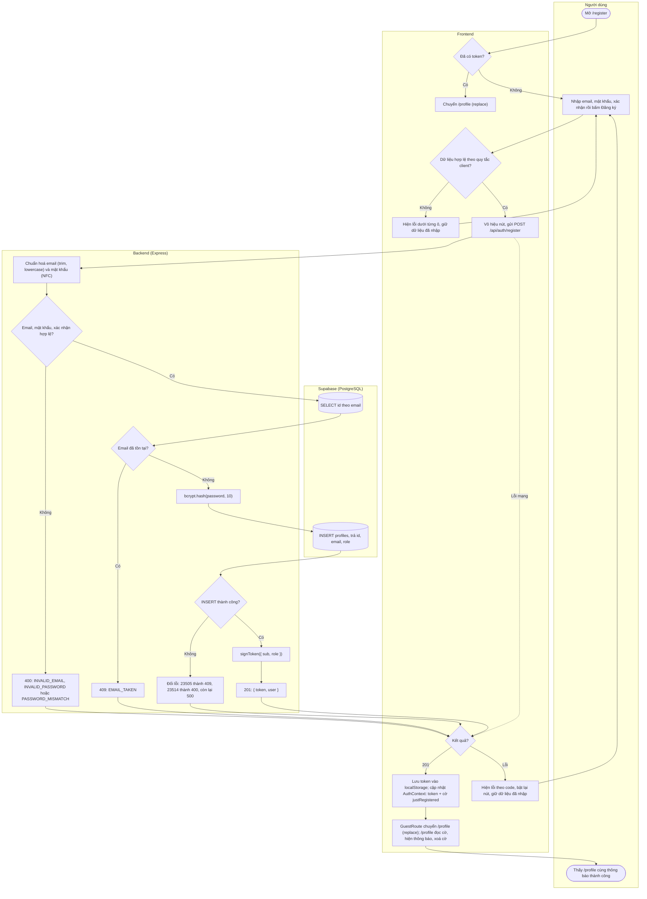

# Flow: Đăng ký

US-01. API: [PRD 4.1](../PRD.md#41-post-apiauthregister). Quyết định: D1, D3, D7. Cột DB: [schema mục 3](../database/schema.md#3-bảng-profiles).

## Nhánh lỗi

| Điều kiện | HTTP | Thông báo cho người dùng | Hành vi UI |
|-----------|------|--------------------------|------------|
| Email sai định dạng | Client chặn; server `400 INVALID_EMAIL` | Email không hợp lệ. | Lỗi dưới ô email, không gửi request |
| Mật khẩu không đạt tiêu chí | Client chặn; server `400 INVALID_PASSWORD` | Mật khẩu cần ít nhất 8 ký tự, gồm chữ và số, tối đa 72 ký tự (ít hơn nếu dùng chữ có dấu). | Lỗi dưới ô mật khẩu |
| Xác nhận không khớp | Client chặn; server `400 PASSWORD_MISMATCH` | Mật khẩu xác nhận không khớp. | Lỗi dưới ô xác nhận |
| Email trùng, kể cả hai request đồng thời | `409 EMAIL_TAKEN` | Email này đã được sử dụng. | Lỗi dưới ô email, kèm link "Đăng nhập" |
| CHECK DB từ chối (backend validate thiếu) | `400 VALIDATION_ERROR` | Dữ liệu không hợp lệ. Vui lòng kiểm tra lại. | Thông báo trên form; không lộ tên constraint |
| Lỗi server | `500 INTERNAL_ERROR` | Đã có lỗi xảy ra. Vui lòng thử lại. | Thông báo trên form, giữ dữ liệu |
| Lỗi mạng | Không có | Không thể kết nối tới máy chủ. Vui lòng thử lại. | Thông báo trên form, giữ dữ liệu |
| Mất mạng đúng lúc tài khoản vừa tạo xong, người dùng gửi lại | `409 EMAIL_TAKEN` | Email này đã được sử dụng. | Link "Đăng nhập" là lối ra; không mất dữ liệu |

## Ghi chú

- Đăng ký thành công **luôn** về `/profile`, không xét `from`: hồ sơ trống là bước kế tiếp bắt buộc để thử đồ.
- `GuestRoute` thực hiện chuyển trang khi token xuất hiện; trang đăng ký không tự gọi `navigate` ([chi tiết](logout-protected-routes.md#hành-vi-frontend)).
- **Thông báo thành công:** "Tạo tài khoản thành công. Hãy hoàn thiện hồ sơ để bắt đầu thử đồ." Trang đăng ký đặt token và cờ `justRegistered` trong `AuthContext` trong cùng một lần cập nhật. `/profile` đọc cờ, hiện thông báo rồi xoá cờ (tiêu thụ một lần). Không dùng state router. Cờ chỉ nằm trong bộ nhớ: tải lại trang thì không hiện lại.
- **Link giữa `/login` và `/register`** không chuyển tiếp `state.from`, nên `GuestRoute` trên `/register` luôn rơi vào mặc định `/profile`.
- `409` tiết lộ email đã tồn tại. Đây là yêu cầu của US-01; rủi ro dò email được giảm khi có rate limit ([PRD mục 7](../PRD.md#7-rủi-ro-đã-chấp-nhận-và-đề-xuất-backlog)).
- Không log `password`, `confirmPassword`.
