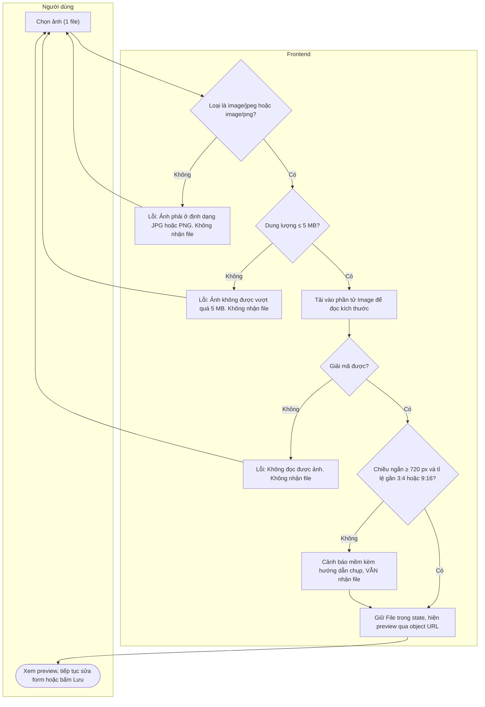
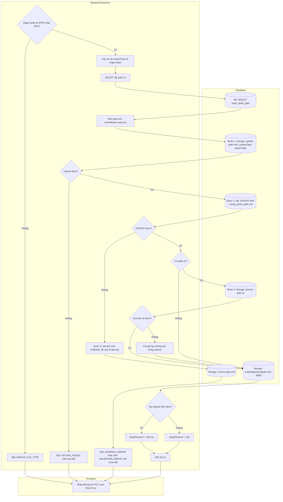

# Flow: Upload và thay ảnh toàn thân

US-02 (sprint backlog gọi là "avatar"). Là phần file của `PUT /api/user/profile` ([PRD 4.4](../PRD.md#44-put-apiuserprofile), [flow hồ sơ](profile.md)), không có endpoint riêng. Quyết định: D9, D10, D13, D15, D16. Bucket và thứ tự thay ảnh: [schema mục 4](../database/schema.md#4-storage-bucket-body-photos).

## Chọn ảnh ở client

## Xử lý ở server (có file trong `PUT`)

Chạy sau khi field đã hợp lệ. Các bước 1–4 của schema mục 4 được đánh dấu trong sơ đồ.

## Nhánh lỗi

| Điều kiện | HTTP | Thông báo cho người dùng | Hành vi UI |
|-----------|------|--------------------------|------------|
| File sai loại (không phải jpg/jpeg/png, gồm HEIC) | Client chặn; server `400 INVALID_FILE_TYPE` | Ảnh phải ở định dạng JPG hoặc PNG. | Lỗi tại vùng chọn ảnh; giữ ảnh hiện tại |
| Đổi đuôi file giả mạo (vd `.exe` thành `.jpg`) | Thường bị chặn ở bước giải mã client; server `400 INVALID_FILE_TYPE` | Client: Không đọc được ảnh. Vui lòng chọn ảnh khác. | Không nhận file |
| File vượt 5 MB | Client chặn; server `413 FILE_TOO_LARGE` | Ảnh không được vượt quá 5 MB. | Lỗi tại vùng chọn ảnh |
| Ảnh không đúng ratio hoặc nhỏ hơn khuyến nghị | Không có lỗi (không tới server) | Cảnh báo: "Ảnh có thể chưa phù hợp để thử đồ. Nên dùng ảnh toàn thân, đứng thẳng, dọc tỉ lệ 3:4 hoặc 9:16, chiều ngắn từ 720 px." | Không chặn; hiện cạnh preview kèm nút chọn ảnh khác |
| Gửi nhiều file, sai tên part, multipart hỏng | `400 INVALID_UPLOAD` | Dữ liệu tải lên không hợp lệ. Vui lòng thử lại. | Thông báo trên form (UI bình thường không gây ra) |
| Upload Storage lỗi | `500 UPLOAD_FAILED` | Không thể tải ảnh lên lúc này. Vui lòng thử lại. | Giữ form và file; **chưa có gì được lưu**, kể cả field hợp lệ |
| Ghi DB lỗi sau khi upload | `500 INTERNAL_ERROR` | Đã có lỗi xảy ra. Vui lòng thử lại. | Giữ form và file; ảnh mới đã được rollback, ảnh cũ còn nguyên |
| Xoá ảnh cũ lỗi | `200` | Lưu thành công. | Bình thường; backend ghi log |
| Tạo signed URL lỗi sau khi lưu | `200`, `bodyPhotoUrl: null` | Lưu thành công. | Tiếp tục hiện preview cục bộ từ file vừa chọn |
| Mất mạng, timeout 60 giây | Không có | Không thể kết nối tới máy chủ. Vui lòng thử lại. | Giữ form và file. Server có thể đã lưu xong; gửi lại an toàn vì ảnh sau thay ảnh trước |

## Quy tắc kiểm tra kích thước

- Đọc `naturalWidth`, `naturalHeight` từ phần tử `Image`; giá trị đã tính hướng xoay EXIF trên trình duyệt hiện đại.
- `ratio = rộng / cao`. Đạt khi `|ratio - 0.75| ≤ 0.03` hoặc `|ratio - 0.5625| ≤ 0.03`, và `min(rộng, cao) ≥ 720`. Ảnh ngang luôn bị cảnh báo.
- Input dùng `accept="image/jpeg,image/png"`, `multiple` tắt. Hướng dẫn chọn ảnh luôn hiển thị, không chờ đến khi có lỗi.

## Signed URL hết hạn khi mở trang lâu

TTL 1 giờ. Ảnh đã hiển thị vẫn còn trên màn hình; chỉ lần tải lại ảnh mới lỗi.

1. `` gọi lại `GET /api/user/profile`, **chỉ cập nhật `bodyPhotoUrl`**, không đổ đè các ô form đang sửa. Nếu form có thay đổi thì ghi bản nháp trước ([flow hồ sơ](profile.md#giữ-bản-nháp)).
2. Tải lại ảnh tối đa một lần cho mỗi lần hỏng, tránh lặp vô hạn.
3. Vẫn lỗi, hoặc `bodyPhotoUrl` là `null`: hiện ô trống "Không tải được ảnh" kèm nút Thử lại và vẫn cho chọn ảnh mới. Có thể gặp với tài khoản seed `buyer.full` (path chưa có object thật).

## Ghi chú bảo mật

- Path do server sinh từ `sub` trong JWT và thời gian; không dùng tên file hay MIME từ client, nên không có path traversal và không lưu được file giả dạng.
- Bucket private, không có policy; bucket chặn thêm một lớp 5 MB và MIME ([schema mục 4](../database/schema.md#4-storage-bucket-body-photos)). Xoá object qua Storage API.
- Không log signed URL. Object URL của preview phải được thu hồi khi bỏ file hoặc rời trang.
- Rollback lỗi hoặc hai lần lưu đồng thời có thể để lại object mồ côi; chấp nhận ở Sprint 1 ([PRD mục 7](../PRD.md#7-rủi-ro-đã-chấp-nhận-và-đề-xuất-backlog)).
